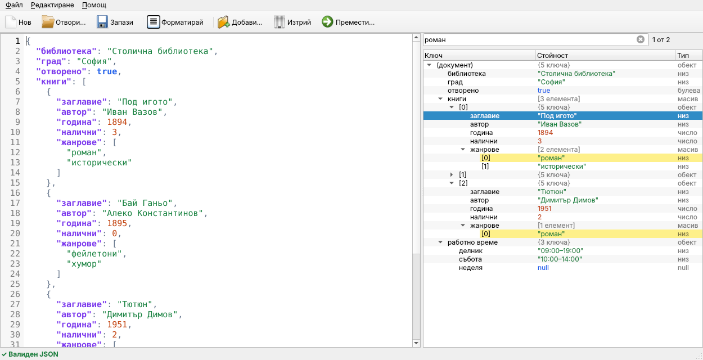
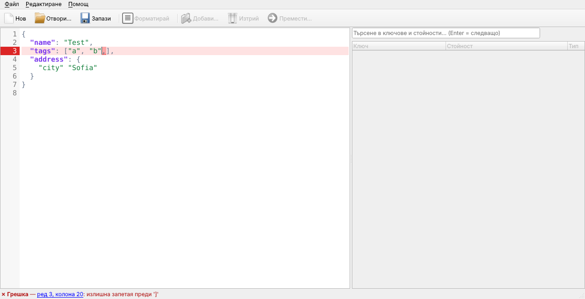

# json_parser

[](https://github.com/Daneto123/json_parser/actions/workflows/build.yml)

**JSON парсер на C++ с Qt прозорец и конзолна версия.** Проверява JSON и показва **точно къде е грешката**, показва документа като дърво и позволява да се търси, променя, добавя, изтрива и мести по път, например `address/city`.

Проектът е писан по предмета „Обектно-ориентирано програмиране“ през летния семестър на 2019/2020 г. Оригиналната версия е запазена непроменена в бранча [`university-2020`](https://github.com/Daneto123/json_parser/tree/university-2020), заедно с Qt опитите от 2024 и 2026 г. Документацията от тогава е в [documentation.pdf](documentation.pdf).



## Какво може

- **Истински парсер.** Обекти, масиви, низове (с интервали, кирилица, `\n`, `ж`, емоджи), числа, `true`/`false`/`null`, вложени колкото трябва. Числата се записват точно както са били (`1.50` остава `1.50`), а ключовете остават в същия ред.
- **Ясни грешки с ред и колона.** Например:
  - `ред 3, колона 20: излишна запетая преди ']'`
  - `ред 5, колона 12: очаквам ':' след ключа "city", а намерих '"'`
  - `ред 1, колона 7: непозната дума 'True' (пише се true)`
  - `ред 2, колона 15: очаквам ',' или ']' в масива (отворен на ред 2), а намерих '}'`

  Хваща и единични кавички, коментари, повторени ключове, числа като `007`, незатворени низове и скоби.
- **Пътища:** `address/city`, `phoneNumbers/0/number`. В масив `-` означава „в края“.
- **Търсене** по ключ (точно съвпадение) или по текст в ключове и стойности, без значение от малки и главни букви, включително на кирилица.

### Прозорецът

- Редактор с номерация на редовете и оцветяване. Проверката става **докато пишеш**: грешният ред се оцветява в червено, а с клик на грешката в долния ред курсорът отива точно там.
- Дърво на документа. Двоен клик сменя стойност или преименува ключ, а с десен бутон има *Добави / Промени / Изтрий / Премести*.
- Търсене (`Ctrl+F`): намерените места се оцветяват, а `Enter` минава към следващото.
- **Форматирай** (`Ctrl+Shift+F`) подрежда отстъпите, а **Компактен** събира всичко на един ред. Всичко се отменя с `Ctrl+Z`.
- Отваря и **невалидни файлове**, за да ги поправиш. Предупреждава за незапазени промени. Файл може да се отвори и като се пусне с мишката върху прозореца.



### Конзолата

```
> open examples/person.json
Отворен е "examples/person.json".
> print address
{
  "streetAddress": "21 2nd Street",
  "city": "New York",
  "state": "NY",
  "postalCode": "10021-3100"
}
> search number
  phoneNumbers/0/number = "212 555-1234"
  phoneNumbers/1/number = "646 555-4567"
Намерени: 2
> set address/city Sofia
Променено: address/city = "Sofia"
> move phoneNumbers/1 work
Преместено: phoneNumbers/1 → work
> save
```

| Команда | Действие |
|---|---|
| `open <файл>` / `close` | отваря / затваря файл |
| `save` / `saveas <файл>` | записва |
| `validate [файл]` | проверява и казва къде е грешката |
| `print [път]` | показва целия файл или част от него |
| `search <ключ>` | всички места с този ключ |
| `find <текст>` | търси текст в ключове и стойности |
| `set <път> <стойност>` | сменя стойност |
| `create <път> <стойност>` | добавя нов ключ или елемент |
| `delete <път>` | изтрива |
| `move <от> <към>` | премества |
| `help` / `exit` | помощ / изход |

Стойността може да е JSON (`42`, `true`, `null`, `[1, 2]`, `{"a": 1}`, `"текст"`) или просто текст: `set address/city New York`. Ако има незапазени промени, `exit` и `close` първо предупреждават.

## Компилиране

Нужни са CMake 3.16+, компилатор с C++17, а за прозореца **Qt 6.2+**. Без Qt се компилира само конзолната версия.

**Qt Creator:** *File → Open File or Project* → `CMakeLists.txt` → Run.

**От командния ред:**

```bash
cmake -B build -DCMAKE_PREFIX_PATH=/път/до/Qt/6.7.1/mingw_64
cmake --build build --config Release
```

Изпълнимите файлове са `json_gui` (прозорецът) и `json_cli` (конзолата). На Linux/macOS всичко прави `./build.sh`.

## Тестове

```bash
ctest --test-dir build -C Release --output-on-failure
```

Тестовете са 176 проверки и покриват:
- парсване на всички примери и на низове с escape-и и Unicode;
- над 25 вида грешки с **точен ред и колона**, включително с кирилица преди грешката;
- запис и обратно парсване без загуба;
- пътищата, търсенето, добавяне, изтриване и местене (при грешка документът не се променя);
- цяла конзолна сесия: отваряне, промени, записване и четене обратно.

Отделно парсерът е пускан срещу 300 000 случайно повредени JSON текста под AddressSanitizer: нито един срив. GitHub Actions компилира и тества на Windows, Linux и macOS при всеки push.

## Структура

```
src/core/     парсерът, без Qt
  value.*       JSON стойност (обектите пазят реда на ключовете)
  parser.*      парсер с грешки по ред и колона
  writer.*      запис (форматиран или на един ред)
  path.*        пътища, търсене, добавяне/изтриване/местене
  document.*    отворен файл, атомарен запис
  shell.*       конзолните команди
src/cli/      конзолната програма
src/gui/      Qt 6 прозорецът (редактор, оцветяване, дърво)
tests/        тестове
examples/     примерни файлове (един от тях нарочно с грешки)
```
